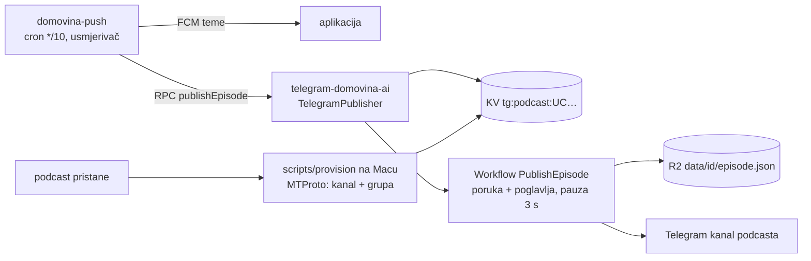

# telegram.domovina.ai

Telegram kanal po podcastu za [domovina.ai](https://domovina.ai). Podcast koji
pristane dobiva vlastiti Telegram **kanal** (svaka nova epizoda + njena poglavlja,
svaka poruka vodi točno na taj trenutak na domovina.ai) i uz njega povezanu
**grupu za raspravu** (komentari ispod svake objave).

Iza kanala stoji domovina.ai: vlastiti bot, vlastiti Telegram račun, vlastiti
Worker. Nijedan link ne vodi na YouTube.

Kad se epizoda javlja odlučuje **[`domovina-push`](https://github.com/domovinatv/domovina-push)**,
glavni usmjerivač obavijesti domovina.ai (postavke kanala, tihi sati, spremnost, bez
duplikata). Ovaj repo je njegov **Telegram dostavljač**.



## Dijelovi

| Gdje | Što |
|---|---|
| `src/publisher.ts` | RPC `TelegramPublisher.publishEpisode`: ima li podcast kanal, je li epizoda novija od kanala, pokreni Workflow (id `ep-<video>-<UC>`, nikad dvaput) |
| `src/workflow.ts` | Workflow `PublishEpisode`: čita `episode.json` iz R2, šalje poruku epizode pa sva poglavlja tiho; svaki korak memoiziran |
| `src/index.ts` | HTTP: mapiranje (provisioner), javni `{title, link}`, ručno pokretanje |
| `scripts/provision/` | MTProto provisioner ([teleproto](https://github.com/sanyok12345/teleproto)), jer Bot API ne može stvoriti kanal ni grupu |

## Pristanak = stvaranje kanala

Kanal nosi ime tuđeg podcasta, pa nastaje **samo kad podcast pristane**, i tada se
stvara jednom, ručno: `scripts/provision` → `npm run create-channel`. Postojanje
kanala JE zapis pristanka; nema zasebne zastavice. Ime je „<Podcast> · domovina.ai”.
U kanal idu samo epizode objavljene od dana stvaranja kanala. Vlasnik koji u
postavkama kanala isključi `push_notifications` (ili povuče kanal) utišava i Telegram.

## API

| Ruta | Auth | Što |
|---|---|---|
| `GET /` | – | zdravlje |
| `GET /public/podcasts/{UC…}` | – | `{title, link}` za gumb „Pridruži se” (CORS, 5 min cache) |
| `GET /podcasts/{UC…}` | bearer | puno mapiranje |
| `PUT /podcasts/{UC…}` | bearer | upis mapiranja (provisioner) |
| `POST /podcasts/{UC…}/episodes/{videoId}` | bearer | ručno pokreni objavu (test prvog kanala) |
| RPC `TelegramPublisher.publishEpisode` | service binding | `{videoId, youtubeChannelId, date}` → `started` / `exists` / `no_channel` / `before_channel` |

## Postavljanje

```sh
npm ci && npm test && npm run typecheck
cp .dev.vars.example .dev.vars          # API_TOKEN (openssl rand -hex 32), TELEGRAM_BOT_TOKEN
npx wrangler secret put API_TOKEN
npx wrangler secret put TELEGRAM_BOT_TOKEN
npm run deploy                          # PRIJE domovina-push (service binding)

cd scripts/provision && npm ci && npm run login   # zaseban Domovina Telegram račun
```

## Licenca

MIT
