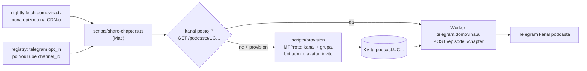

# telegram.domovina.ai

Telegram kanal po podcastu za [domovina.ai](https://domovina.ai). Podcast koji
pristane dobiva vlastiti Telegram **kanal** (svaka nova epizoda + njena poglavlja,
svaka poruka vodi točno na taj trenutak na domovina.ai) i uz njega povezanu
**grupu za raspravu** (komentari ispod svake objave).

Iza kanala stoji domovina.ai: vlastiti bot, vlastiti Telegram račun, vlastiti
Worker. Nijedan link ne vodi na YouTube.



## Dijelovi

| Gdje | Što |
|---|---|
| `src/` | Cloudflare Worker na `telegram.domovina.ai`: mapiranje u KV + objava kroz Bot API |
| `scripts/provision/` | MTProto provisioner ([teleproto](https://github.com/sanyok12345/teleproto)), jer Bot API ne može stvoriti kanal ni grupu. Vidi njegov README |
| `scripts/share-chapters.ts` | petlja na Macu iza nightlyja: nove epizode podcasta s pristankom → njihov kanal |

## Pristanak

Kanal nosi ime tuđeg podcasta, pa nastaje **samo uz pristanak**: na unosu podcasta u
[`fetch.domovina.tv/data/podcasts_registry.json`](https://github.com/domovinatv/fetch.domovina.tv/blob/main/data/podcasts_registry.json)
dodaj `"telegram": {"opt_in": "YYYY-MM-DD"}`. Ime kanala je „<Podcast> · domovina.ai”.
Kanal se stvara lazy, kad podcast dobije prvu novu epizodu. Stari katalog se ne objavljuje.

## API

| Ruta | Auth | Što |
|---|---|---|
| `GET /` | – | zdravlje |
| `GET /public/podcasts/{UC…}` | – | `{title, link}` za gumb „Pridruži se” (CORS, 5 min cache) |
| `GET /podcasts/{UC…}` | bearer | puno mapiranje |
| `PUT /podcasts/{UC…}` | bearer | upis mapiranja (provisioner) |
| `POST /podcasts/{UC…}/episode` | bearer | `{id, title, abstract?, chapters?}` |
| `POST /podcasts/{UC…}/chapter` | bearer | `{id, sec, title}`, tiho |

Ključ je YouTube `channel_id`, ne slug pipelinea: Tier 2 epizode žive u `_unlisted/`.

## Postavljanje

```sh
npm ci
cp .dev.vars.example .dev.vars          # API_TOKEN (openssl rand -hex 32), TELEGRAM_BOT_TOKEN
npx wrangler secret put API_TOKEN
npx wrangler secret put TELEGRAM_BOT_TOKEN
npm run deploy

cd scripts/provision && npm ci && npm run login   # zaseban Domovina Telegram račun
```

Petlja: `npm run share -- --dry-run`, pa `--seed` jednom, pa u nightly
`npm run share -- --provision`.

## Licenca

MIT
