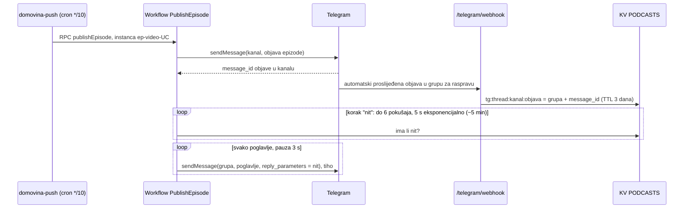
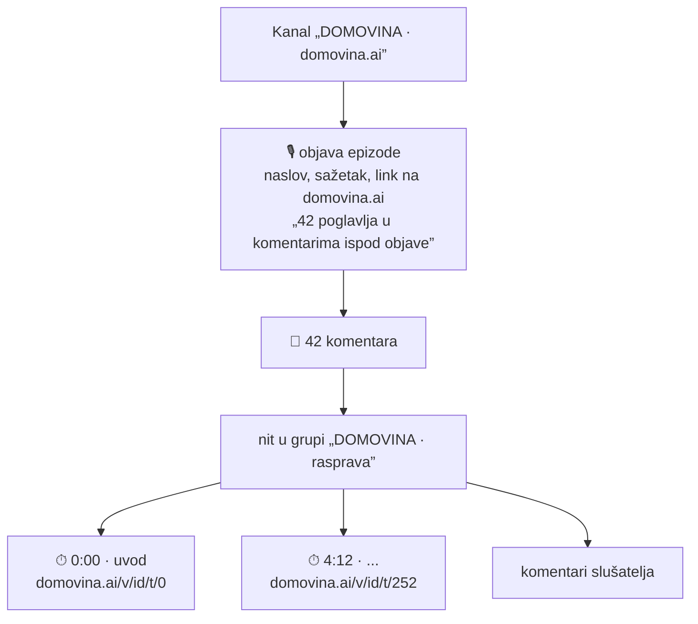
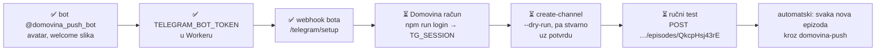

# Poglavlja u komentarima i prvi kanal (DOMOVINA)

Datum: 19. 11. 2026. Status: **prvi kanal radi** (19. 11. 22:12): kanal „DOMOVINA · domovina.ai”
(`-1003930493648`, https://t.me/+A91C5KOxeFBhNjA0) + grupa „DOMOVINA · rasprava”
(`-1004444601313`, odmah stvorena kao supergrupa). Test `QkcpHsj43rE`: objava u kanalu i 42
poglavlja u komentarima, Workflow `Completed`. **Privremeno je vlasnik osobni račun**; kad
stigne SIM za Domovina račun, vlasništvo se prebacuje (§7).

## 1. Odluka

U kanal ide **samo objava epizode**. Sva poglavlja idu kao **komentari ispod te objave**
(nit u povezanoj grupi za raspravu). Kanal ostaje jedna objava po epizodi; tko želi
poglavlja otvori komentare, i ista nit je mjesto za razgovor o epizodi.

Zašto: epizoda ima 30–46 poglavlja. U kanalu bi ih svaki pretplatnik dobio kao zid poruka,
a Telegram nema oznake koje bi korisnik mogao ugasiti. Komentari rješavaju isto što bi
riješio filter, bez filtera.

| | Kanal | Supergrupa | Supergrupa s temama (forum) |
|---|---|---|---|
| Tko piše | samo admini / bot | svi (može se ograničiti) | svi, po temama |
| Članova | neograničeno | do 200 000 | do 200 000 |
| Komentari | nit ispod objave, kroz povezanu grupu | jedan tok | tema = zaseban tok |
| Što korisnik može ugasiti | cijeli kanal | cijelu grupu | svaku temu posebno (sakriti ne može) |
| Filtriranje | `#hashtag` = pretraga, ništa ne skriva | isto | teme + hashtag |

Odbačeno:

- **Forum umjesto kanala** (teme „Epizode” / „Poglavlja”, korisnik utiša poglavlja): nema
  doživljaja kanala, a grupa s temama, koliko znamo, ne može biti grupa za raspravu kanala.
- **Sve u kanal** (prijašnje stanje): poglavlja su tiha, ali kanal postaje dugačak.

Kanal bez grupe za raspravu (`discussionChatId: null`) i dalje dobiva poglavlja izravno u
kanal, pa stara mapiranja ne pucaju.

## 2. Kako poglavlje nađe svoju nit

Bot API pri slanju u kanal ne kaže koji je id iste objave u grupi za raspravu. Telegram je
tamo proslijedi sam (`is_automatic_forward`), pa ga hvata webhook bota i ostavlja u KV-u,
a Workflow ga čeka.



- Webhook prima samo `message` updateove i odbija sve bez zaglavlja
  `X-Telegram-Bot-Api-Secret-Token` (tajna `TELEGRAM_WEBHOOK_SECRET`).
- Sve ostalo što stigne (komentari ljudi, vlastite poruke bota) samo se potvrdi s 200.
- Ako je objava proslijeđena u drugu grupu nego što kaže mapiranje, Workflow staje
  (`NonRetryableError`): netko je ručno promijenio grupu za raspravu.
- Bot mora biti **admin u grupi** da bi primao sve poruke; `create-channel` ga tamo postavlja.

## 3. Što korisnik vidi



Svaki link vodi na domovina.ai, nikad na YouTube.

## 4. Ograničenja Telegrama

- **Jedan Domovina račun** je vlasnik svih kanala i grupa. Račun može biti član najviše
  **500 kanala i supergrupa** ukupno (1000 s Premiumom); vlasnik je i član, a podcast troši
  2 mjesta, pa račun nosi **oko 250 podcasta**. Bot to ograničenje nema.
- Javna imena (`t.me/ime`) su zasebno ograničena; kanali zato idu s privatnim invite linkom.
- Bot u jedan chat šalje ~20 poruka u minuti, otud pauza od 3 s (46 poglavlja ≈ 2,5 min).
- Brzo stvaranje kanala zaredom dobiva `FLOOD_WAIT`; kanali se stvaraju ručno, jedan po jedan.

## 5. Prvi kanal: DOMOVINA (`domovina.ai/c/domovina-tv`)

| | |
|---|---|
| YouTube `channel_id` | `UCXXhnehl2pss0uYdfLRDtyw` |
| Kanal pipelinea | `domovina_tv` |
| Avatar | `https://cdn.domovina.ai/channels/images/domovina_tv/avatar_square.jpg` |
| Naziv kanala | „DOMOVINA · domovina.ai”, grupa „DOMOVINA · rasprava” |
| Test epizoda | `QkcpHsj43rE` (AI u praksi: Claude Code uživo) |



Koraci:

1. **Prijava računa** (jednom):
   `! cd ~/git/domovinatv/telegram.domovina.ai/scripts/provision && npm run login`,
   ispisani `TG_SESSION` upisati u `scripts/provision/.env` (ne u chat).
2. **Suho pokretanje:**
   ```bash
   npm run create-channel -- UCXXhnehl2pss0uYdfLRDtyw \
     --title "DOMOVINA · domovina.ai" \
     --avatar https://cdn.domovina.ai/channels/images/domovina_tv/avatar_square.jpg \
     --dry-run
   ```
3. **Stvarno stvaranje**, ista naredba bez `--dry-run`, tek uz izričitu potvrdu (vanjski,
   teško povratan potez). Skripta upiše mapiranje u KV (`PUT /podcasts/UC…`).
4. **Ručni test** jedne epizode:
   ```bash
   curl -X POST -H "Authorization: Bearer $API_TOKEN" \
     https://telegram.domovina.ai/podcasts/UCXXhnehl2pss0uYdfLRDtyw/episodes/QkcpHsj43rE
   ```
   Provjera: jedna objava u kanalu, ispod nje komentari s poglavljima; `wrangler tail`
   pokazuje `thread_root`.
5. Od tada `domovina-push` sam šalje svaku novu epizodu kanala objavljenu od dana
   stvaranja kanala (pravilo „samo nove epizode”).

## 6. Povratak

- Zaustaviti objave za jedan podcast: obrisati KV ključ `tg:podcast:<UC>` → `no_channel`.
- Ugasiti nit poglavlja: `deleteWebhook` bota; Workflow tada nakon ~5 min odustane na
  koraku „nit” (objava epizode ostaje, poglavlja ne idu).
- Kanal i grupa se brišu samo ručno, s Domovina računa.

## 7. Naučeno na prvom kanalu (19. 11.)

- **Nit stiže kroz webhook za sekundu, ali Workflow je vidi tek nakon ~1–1,5 min**: korak
  „nit” je pao 3–4 puta prije uspjeha. KV nije odmah vidljiv na lokaciji koja čita, a i
  promašaj (ključ još ne postoji) se kratko pamti. Pokušaji 5/10/20/40/80 s to pokriju.
  Ako ikad zatreba brže: webhook javlja instanci kroz `step.waitForEvent` umjesto KV-a.
- `TogglePreHistoryHidden(false)` na novoj supergrupi vrati `ChatNotModifiedError`: povijest je
  već vidljiva, upozorenje je bezopasno.
- Izlaz koraka `poglavlje-*` u `wrangler workflows instances describe` je `message_id` poslanog
  komentara, ne redni broj poglavlja (zadnji je bio 46 za 42 poglavlja: objava je poruka 4).
  Broj poglavlja = broj koraka `poglavlje-*`.
- Ograničenje računa koje Telegram šalje (`help.getAppConfig`): `channels_limit_default` 500,
  `channels_limit_premium` 1000.
- Kanal je stvorio osobni račun (Domovina račun čeka drugi broj; Telegram traži jedan broj po
  računu). Predaja vlasništva: u kanalu i grupi dodati Domovina račun kao admina, pa
  „Transfer ownership” (traži 2FA na osobnom računu), zatim novi `npm run login` s Domovina
  računom i zatvoriti sesiju „domovina-automatic” na osobnom.
